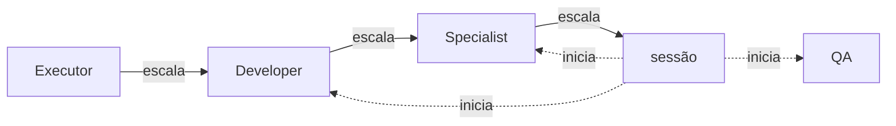

# squad

Orquestração de agentes por complexidade para Claude Code e OpenCode, baseada no
[aiwkf](https://github.com/k8adev/aiwkf/blob/main/plugins/agents/README.pt-BR.md).

Os agentes são separados pelo julgamento que a tarefa exige, não por cargo. A sessão principal
orquestra (decide, sequencia, conversa com você) e os agentes fazem o trabalho.

## A squad

Os nomes descrevem a função, não o cargo. A ordem é de julgamento: Executor → Developer →
Specialist é a escada de escalonamento. Você é o PO: produto, prioridade, dinheiro e produção são decisões suas.

| Agente | No aiwkf | Quando usar | Claude | OpenCode |
|---|---|---|---|---|
| Executor | Operator | Mudança já decidida até o último detalhe, inclusive escritas MCP/API/`glab` | haiku | deepseek-v4.1-flash |
| Analyst | Researcher | Investigação somente leitura de qualquer fonte | sonnet / medium | gpt-6-sol |
| Developer | Builder | Implementação com escopo, decisões pequenas, sem padrão novo | sonnet / medium | gpt-6-sol |
| Specialist | Specialist | Transversal, sem padrão, ou zona de risco (migration, dinheiro, auth, concorrência, agenda, LGPD) | opus / high | gpt-6-astra |
| Reviewer | Reviewer | Validar plano, diff, texto ou decisão antes de seguir | opus / high | gpt-6-astra |
| QA | — | Rodar testes/build/browser em ambiente isolado e só reportar | sonnet / medium | gpt-6-sol |



Cada agente fecha com uma linha só: `done`, `not done: …`, `open decision: …` ou
`escalate to <agente>: …`. O Reviewer abre com `VERDICT: SOUND | ADJUST | OBJECT | ESCALATE` e o
QA com `RESULT: PASS | FAIL | BLOCKED`. A skill `orquestrar` diz o que a sessão faz com cada
uma.

Diferenças em relação ao aiwkf:

- **QA**, um sexto papel que prova com execução (testes, Playwright, banco isolado
  `<db>_<slug>`) e nunca corrige.
- **Zonas de risco** explícitas, que vão para o Specialist e passam pelo Reviewer; produção é
  sempre decisão do usuário.
- **Fonte única**: o contrato compartilhado fica em `src/partials/` e o
  `scripts/build.py` gera os agentes dos dois hosts. O `test.sh` falha se um gerado for editado
  à mão.
- Tudo em pt-BR.

## Estrutura

```
plugins/squad/
  src/roles.json          metadados por papel (descrição, modelo, permissões por host)
  src/roles/<papel>.md    corpo de cada papel, com {{partials}} e blocos por host
  src/partials/*.md       contrato compartilhado
  src/orquestrar.md       manual do orquestrador
  agents/                 GERADO: agentes do Claude Code
  skills/orquestrar/      GERADO: skill do Claude Code
  skills/entregar/        skill de entrega spec → MR/PR (escrita à mão)
  opencode/agents/        GERADO: subagentes do OpenCode + agente primário `lead`
  scripts/build.py        gera tudo; --check confere
  scripts/test.sh         paridade de nomes, manifests, gerados em dia
  scripts/install-opencode.sh
```

Para mudar algo: edite `src/`, rode `python3 plugins/squad/scripts/build.py` e depois
`bash plugins/squad/scripts/test.sh`.

## Entregar uma spec

`/squad:entregar <origem>` leva uma spec até um MR/PR aberto. A origem pode ser:

- `.specs/features/<slug>/` ou só o `<slug>`: spec local, nos formatos tlc-spec-lean
  (`plan.md` + `checks.md`), tlc-spec-driven (`spec.md`, `design.md`, `tasks.md`) ou um arquivo
  livre;
- uma issue do GitLab ou GitHub, inclusive de outro projeto, ou de outro tracker via MCP.

Uma spec que vem de issue é copiada primeiro para `.specs/features/<slug>/spec.md`, com a linha
`Origem:`, e vira o primeiro commit da branch. O plano de execução, o estado e os rulings ficam
em `.specs/features/<slug>/entrega.md`, versionados junto com a spec, então dá para retomar uma
entrega interrompida rodando o comando de novo na mesma branch. Não depende do superpowers.

As versões antigas da `entregar-issue-gitlab` estão em `legado/`.

## Instalação

**Claude Code**

```
claude plugin marketplace add ~/tools/projects/squad
claude plugin install squad@squad
```

Os agentes aparecem como `squad:Developer` etc. e a skill como `squad:orquestrar`. Depois de
editar `src/` e rodar o build, atualize com `claude plugin marketplace update squad` e
`claude plugin update squad@squad`, e abra uma sessão nova.

**OpenCode**

```
bash plugins/squad/scripts/install-opencode.sh
```

Isso cria symlinks em `~/.config/opencode/agents/`, então o build atualiza o OpenCode direto.
Para remover, use `--remove`. No OpenCode, `lead` é um agente primário (troque com Tab), e
dá para chamar um papel avulso com `opencode run --agent developer …`.

## Opcional

A skill `orquestrar` é acionada pela descrição, mas não toda vez. Para fazer a sessão principal
sempre passar pela squad, adicione ao `~/.claude/CLAUDE.md`:

```
## Delegação

A sessão orquestra: decide, sequencia e conversa comigo; os subagentes fazem o trabalho.
Antes de qualquer busca, mudança, pesquisa, review ou escrita externa (MCP/API), carregue a
skill `squad:orquestrar`; ela decide se e para quem delegar.
```

## Limites

- Analyst, Reviewer e QA são somente leitura **por contrato**. No Claude, o
  `disallowedTools` bloqueia Edit/Write mas não escrita via Bash ou MCP. No OpenCode, só `edit`
  é negado. Para ter bloqueio de verdade, seria preciso um hook `PreToolUse`.
- Os modelos do OpenCode estão em `src/roles.json` e dependem dos providers que você tem
  autenticados (`opencode models`).
- Delegação aninhada no OpenCode (Specialist consultando o Reviewer) depende da permissão
  `subagent` do host. Se não funcionar, o orquestrador faz a mediação.
